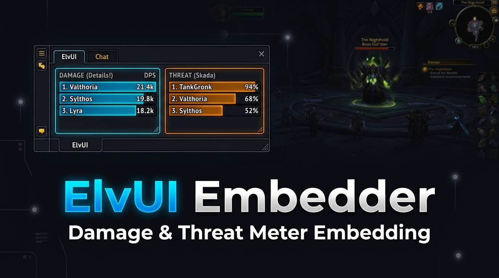

  

  # ElvUI Embedder

  **Clean, lightweight Damage & Threat Meter Embedding into ElvUI Chat Panels across all WoW versions!**

  
  
  
  
  
  
  
  

---

**ElvUI Embedder** is a standalone, GPL-3.0 **ElvUI** plugin that embeds your Damage and Threat Meters cleanly into ElvUI's Right or Left Chat Panel — supporting **Single** and **Dual** side-by-side layouts, automatic resize hooks, combat/group visibility rules, and one-click toggling via ElvUI's `RightChatToggleButton`.

---

## 🎮 Supported WoW Versions

- **Retail (Midnight `12.x`)**
- **Mists of Pandaria Classic (`5.5.x`)**
- **Cataclysm Classic (`4.4.x`)**
- **Wrath of the Lich King Classic (`3.4.x` / `3.8.x`)**
- **The Burning Crusade Classic Anniversary (`2.5.x`)**
- **Classic Era (`1.15.x`) & Classic Forever (`16001`)**

---

## 📊 Supported Meters

- **Details! Damage Meter** *(Single & Dual Window)*
- **Blizzard Damage Meter** *(Retail `12.x`, Single & Dual Window)*
- **Skada** *(Single & Dual Window)*
- **Recount**
- **Omen Threat Meter**
- **TinyDPS**

---

## ⚙️ Features & Commands

- **Single & Dual Embed**: Show 1 meter across the whole chat panel or 2 meters side-by-side (e.g., `Details!` + `Details!` #2, or `Recount` + `Omen`) with adjustable split percentage and gap.
- **Target Panel**: Anchor into **Right Chat** or **Left Chat**, either below the chat tab bar or covering the full panel.
- **Right-Click Chat Toggle**: Right-click ElvUI's `RightChatToggleButton` to toggle the embedded meter without hiding your chat panel.
- **Visibility Modes**: `Always Show`, `Only in Combat`, or `Only in Group / Instance`.
- **Slash Commands**:
  - `/embed` or `/embedder` — Open ElvUI Embedder options
  - `/embed toggle` — Toggle embedded meter visibility
  - `/embed refresh` — Force re-align / re-embed

